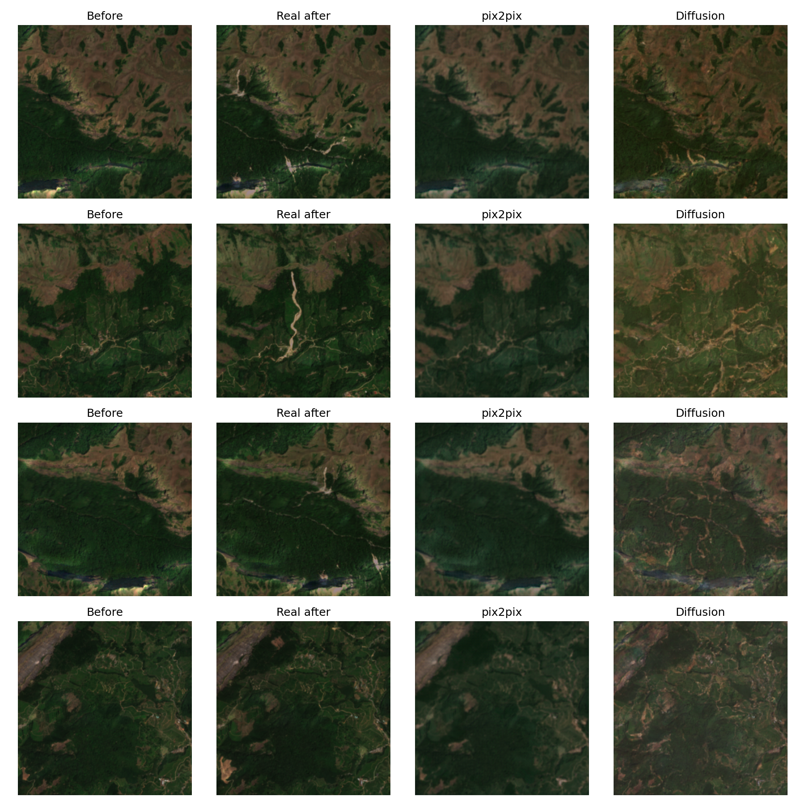

# kerala-hazard-vision-ai: GAN vs diffusion for visualising landslide and flood impact

Two conditional generative models take a real **pre-disaster Sentinel-2 image of an area in
Kerala** and generate a plausible **post-disaster image** at a chosen severity. Both are
conditioned on terrain slope, rainfall and soil type, and both learn from the same data:

- **pix2pix**, a conditional GAN (Isola et al., 2017)
- a **Palette-style conditional diffusion model** (Saharia et al., 2022)

The project compares them head to head, against a "nothing changes" baseline and a zero-shot
Stable Diffusion model.

Hazard maps say "high risk"; this project shows what that risk could *look like*, to help
non-experts understand it.

Generative AI capstone (course M5221352, Digital University Kerala).
Author: Muhammed Shahid S.

> Generated images are plausible scenarios for hazard communication, **not forecasts**.

## How it works

```
Google Earth Engine            kerala_hazard_vision_ai                         Colab notebooks
───────────────────            ───────────────────────                         ───────────────
Sentinel-2 before ─┐           data/severity.py   NDVI/NDWI change → 0–1       01_data
Sentinel-2 after  ─┼─► 11-band data/tiling.py     256×256 tiles (.npz)
Copernicus DEM    ─┤   stack   data/dataset.py    9-channel input, event split
CHIRPS rainfall   ─┤   per     models/            U-Net + PatchGAN (GAN)
OpenLandMap soil  ─┘   event   models/diffusion.py  conditional DDPM / DDIM
                               train.py           pix2pix training, resumable  02_train_pix2pix
                               train_diffusion.py diffusion training, EMA, AMP 03_train_diffusion
                               evaluate.py        SSIM/PSNR/FID, severity, time 04_evaluate
                               diffusion_baseline.py  zero-shot Stable Diffusion
                               human_eval.py      real vs pix2pix vs diffusion
                               demo.py            draw area → severity sweep   05_demo
```

**Model input (9 channels):**
- the before bands B2, B3, B4 and B8
- slope
- 7-day rainfall
- soil texture class
- severity (0–1)
- hazard type (flood = 0, landslide = 1)

**Output:** the 4 after bands. The diffusion model also receives the noisy after image
(13 channels in) and predicts the noise.

**Severity labels** are measured, not hand-labelled. Severity is the share of a tile's
cloud-free pixels whose change matches the hazard:
- landslide: an NDVI (vegetation index) drop
- flood: NDWI (water index) crossing into water

**Events** are listed in [`configs/events.yaml`](configs/events.yaml). Before images are
dry-season composites (Dec–Apr). Landslide after images are the next dry season (scars stay
visible for months). Flood after images come from the days the water was still standing.
- **Kerala floods:** Kuttanad 2018 (held out as the flood test event)
- **Kerala landslides:**
  - Kavalappara 2019
  - Puthumala 2019
  - Pettimudi 2020 (held out as the landslide test event)
  - Kokkayar 2021
  - Wayanad 2024
- **Extra flood training data:** Vijayawada 2024 (Andhra Pradesh), Dadu 2022 (Sindh)
- **Extra landslide training data from the Western Ghats:**
  - Taliye 2021
  - Ambeghar 2021
  - Irshalwadi 2023
  - Shiroor 2024

**Evaluation** uses the two held-out Kerala events (one flood, one landslide) and compares four
methods on each:
- pix2pix
- conditional diffusion
- an identity baseline ("nothing changes")
- zero-shot Stable Diffusion img2img, with 4 prompt designs

It also includes a human survey with real, pix2pix and diffusion images.

## Results

Two held-out Kerala events, never seen in training. All numbers come from
[`outputs/metrics.json`](outputs/metrics.json) and
[`outputs/metrics_damage.json`](outputs/metrics_damage.json); the full write-up is the
[report](report/report.pdf).

| Test event | Method | SSIM ↑ | PSNR (dB) ↑ | FID ↓ | s / tile ↓ |
|---|---|---|---|---|---|
| Pettimudi landslide (256 tiles) | Identity baseline | **0.934** | **32.5** | **25.4** | — |
| | pix2pix (GAN) | 0.885 | 30.9 | 54.2 | **0.006** |
| | Conditional diffusion | 0.740 | 21.4 | 65.7 | 3.62 |
| | Stable Diffusion, best prompt | 0.549 | 24.0 | 195.4 | — |
| Kuttanad flood (40 tiles) | Identity baseline | **0.799** | **22.0** | **213.8** | — |
| | pix2pix (GAN) | 0.624 | 17.1 | 269.3 | **0.007** |
| | Conditional diffusion | 0.675 | 14.8 | 269.2 | 3.92 |
| | Stable Diffusion, best prompt | 0.662 | 20.7 | 320.2 | — |

- **Whole-tile metrics favour copying:** real damage covers about 0.2% of a landslide test
  tile, so "nothing changes" wins SSIM, PSNR and FID.
- **Damage placement** (change-mask overlap): pix2pix marks part of the Kuttanad flood
  (precision 0.74, recall 0.18, F1 0.29); diffusion draws landslide scars that cover 14% of
  the real scar area, but at 0.2% precision.
- **Human evaluation** (8 raters, 21 images): diffusion images were judged real 77% of the
  time, real images 70%, pix2pix 55%; rater accuracy 46%, at chance level.



More figures in [`outputs/figures/`](outputs/figures/): flood comparison, severity sweeps,
diffusion diversity (four seeds), severity consistency, Stable Diffusion comparisons and the
diffusion loss curve.

## Repository layout

| Path | What it holds |
|---|---|
| `src/kerala_hazard_vision_ai/` | All logic, typed and documented |
| `configs/` | Every tunable value (`default.yaml`) and the event list (`events.yaml`) |
| `notebooks/` | Thin Colab drivers, committed with their outputs |
| `tests/` | pytest suite (CPU-only, no network) |
| `tools/survey_form.gs` | Google Apps Script that builds the survey form and exports its answers |
| `report/` | Final report (`report.pdf`); `report.md` is the draft it was edited from |

## Running it

**Tests (any laptop, CPU only):**

```bash
python -m venv .venv
.venv/Scripts/pip install torch torchvision --index-url https://download.pytorch.org/whl/cpu   # Linux/macOS: .venv/bin/pip
.venv/Scripts/pip install -e ".[dev]"
.venv/Scripts/ruff check .
.venv/Scripts/pytest
```

CI runs the same lint and tests on every push (`.github/workflows/ci.yml`).

**Full pipeline (Google Colab, T4 GPU):**

You need a free [Earth Engine](https://earthengine.google.com) non-commercial Cloud project.
Open the notebooks in order. To use your own Earth Engine project, change `GEE_PROJECT` in 01 and 05:

1. `01_data.ipynb`
   - Checks each event box on a map.
   - Runs the cloud-free go/no-go check.
   - Exports the stacks to Drive and tiles them.
2. `02_train_pix2pix.ipynb`
   - Runs an overfit sanity check, then GAN training.
3. `03_train_diffusion.ipynb`
   - Trains the diffusion model (about 3–4 h).
4. `04_evaluate.ipynb`
   - Computes all metrics and figures, the Stable Diffusion comparison and the survey.
5. `05_demo.ipynb`
   - Opens the interactive map: draw an area, pick the model, hazard and rainfall, then
     crossfade through the severities.

Both training notebooks resume from the last epoch when re-run. To train the diffusion model on
Kaggle instead (keeps running in the background), use `kaggle_pack_tiles` (on Colab) and then
`kaggle_train_diffusion` (on Kaggle); instructions are at the top of each.

Both training notebooks resume from the last epoch when re-run. Tiles, checkpoints and outputs
live in `MyDrive/kerala_hazard_vision_ai/`. Copy `outputs/` and the executed notebooks back into
the repo to publish the results.

## Limitations

- **Resolution:** at 10 m, individual buildings are not visible. Only area-scale damage is
  visible, such as landslide scars and flooded fields.
- **Few events:** with 10 events, results describe a small sample, and overlapping tiles make
  the effective sample size smaller than the tile count.
- **Floods:** flood water drains fast and monsoon cloud hides it, so flood after-images use
  short near-event windows with per-pixel cloud masking. A first attempt with a dry-season
  after image (Chalakudy 2018) showed no water at all (median tile severity 0.0001) and was
  replaced. Sentinel-1 radar, which sees through cloud, would give more flood data: future work.
- **Soil:** soil texture is a class number treated as a continuous value.
- **Demo rainfall:** the demo uses a constant rainfall scenario instead of a forecast.
- **Area check:** the demo checks the Kerala bounding rectangle, not the state border.
- **Extrapolation:** severities above the training maximum are extrapolation and are labelled
  so in the demo.
- **Diffusion speed:** diffusion needs 50 denoising steps per image, so it is much slower than
  pix2pix's single pass.

## Data credits

- Copernicus Sentinel-2 and Copernicus DEM GLO-30 (ESA / European Union)
- CHIRPS daily rainfall (UCSB Climate Hazards Center)
- OpenLandMap soil texture (EnvirometriX, CC BY-SA 4.0)
- All accessed through Google Earth Engine
- Stable Diffusion v1.5 (CreativeML OpenRAIL-M licence)

## Methods

- Isola et al., *Image-to-Image Translation with Conditional Adversarial Networks*, CVPR 2017
- Ho et al., *Denoising Diffusion Probabilistic Models*, NeurIPS 2020
- Song et al., *Denoising Diffusion Implicit Models*, ICLR 2021
- Saharia et al., *Palette: Image-to-Image Diffusion Models*, SIGGRAPH 2022
