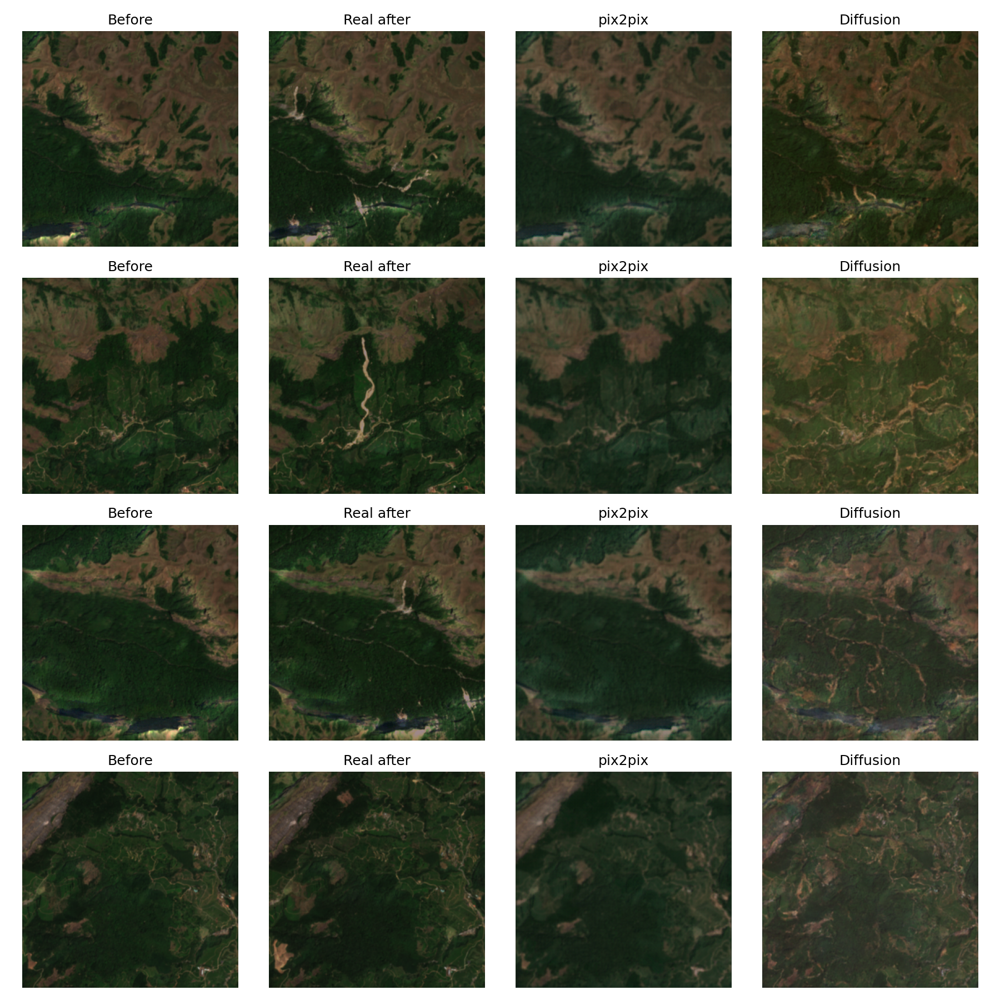
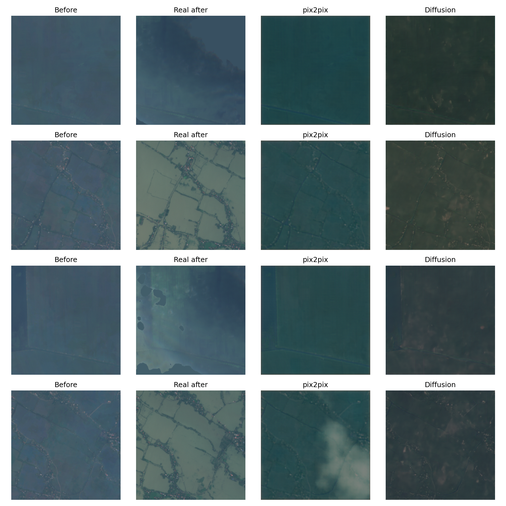
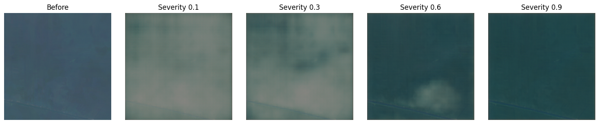

# Visualizing the Unseen: GAN vs Diffusion for Post-Disaster Satellite Imagery of Kerala

**Muhammed Shahid S (253308) · Suryakiran MS (253311)** 
Generative AI (M5221352), Digital University Kerala · 14 November 2026 
Code: [github.com/muhammedshahidsds25-collab/kerala-hazard-vision-ai](https://github.com/muhammedshahidsds25-collab/kerala-hazard-vision-ai)

## Abstract

We trained two conditional generative models that turn a real pre-disaster Sentinel-2 image of an area into a plausible post-disaster image, for landslides and floods, at a requested severity. A pix2pix GAN and a Palette-style conditional diffusion model were trained on the same 2,444 tiles (256 × 256 px, 10 m) from 11 events, conditioned on terrain slope, 7-day rainfall, soil texture, a severity value and the hazard type. On two held-out Kerala events, neither model beat a "nothing changes" baseline on whole-tile SSIM, PSNR or FID (Pettimudi landslide SSIM: baseline 0.934, pix2pix 0.885, diffusion 0.740). Damage-focused scores show where each model helps: pix2pix marks part of the Kuttanad flood correctly (precision 0.74, F1 0.29), while diffusion draws realistic landslide scars but not where they occurred. In a survey of 8 raters, diffusion images were judged real more often (77%) than real images (70%). A pretrained Stable Diffusion model used zero-shot was worst on landslides (SSIM 0.549), so task-specific training mattered.

## 1. Introduction

Landslides and floods are among the most frequent and destructive hazards in Kerala, and their impact is hard to communicate to the people who must act on it. Conventional assessment produces susceptibility maps: probabilities or "high / medium / low" zones that non-experts find abstract.

Generative AI offers a different product: instead of a probability, a picture. A model conditioned on a real satellite image and on terrain and rainfall data can synthesise what that area could look like after a disaster. This reframes hazard communication as conditional image-to-image translation, the setting of pix2pix (Isola et al., 2017) and of image-to-image diffusion models (Saharia et al., 2022).

This project builds and compares both families on real Kerala data. Its contributions are:

1. A reproducible Earth Engine pipeline that builds before/after Sentinel-2 pairs with slope, rainfall, soil and a measured severity label for 11 events.
2. A pix2pix GAN and a Palette-style conditional diffusion model trained on identical data and inputs.
3. An evaluation on two held-out Kerala events against an identity baseline and zero-shot Stable Diffusion, with image metrics, speed, severity control, a damage-focused score and a human survey.
4. A tested Python package (105 unit tests, CI) and an interactive map demo.

## 2. Related work

Conditional GANs are an established tool for disaster imagery. DisasterGAN's PairedAttention GAN generated post-flood aerial images from pre-flood images and topography, and found elevation the most influential input. Lütjens et al. (arXiv:2104.04785) enforced physical consistency when synthesising coastal-flood satellite images for climate communication. A conditional progressive GAN (arXiv:2211.15303) was evaluated with a flood-segmentation model rather than Inception-based scores, which fit satellite imagery poorly. For landslides, a bi-temporal conditional GAN extracted landslides from before/after imagery, and GAN-based data balancing addressed the scarcity of labelled landslides (Al-Najjar et al., 2021).

Our two models follow pix2pix (Isola et al., 2017): a U-Net generator and a 70 × 70 PatchGAN discriminator, trained with an adversarial loss plus L1. Diffusion models (DDPM; Ho et al., 2020) now lead image generation. Palette (Saharia et al., 2022) applies them to image-to-image tasks by concatenating the condition to the noisy target, and DDIM (Song et al., 2021) samples them in few steps. Two lessons from this work shape our evaluation: compare against simple baselines, and add a domain-aware check to generic metrics such as SSIM, PSNR and FID.

## 3. Data

The dataset holds 2,444 tiles from 11 events: 9 landslides in the Western Ghats and 2 floods. Every tile pairs a before and an after image with three conditioning layers, all built in Google Earth Engine and resampled to one 10 m grid (UTM 43N).

**Imagery.** Before images are median composites of the dry season (1 Dec – 30 Apr) preceding each event, when Kerala is least cloudy. Landslide after images use the next dry season: scars stay visible for months and the pair is season-matched. Flood water drains within days, so flood after images use a near-event window. Landslides use Sentinel-2 Level-2A surface reflectance, masked with its scene classification. Floods use Level-1C, because Level-2A is not global before 2019, masked with Google's Cloud Score+ (cs_cdf ≥ 0.6).

**Conditioning layers.** Slope from the Copernicus GLO-30 DEM, rainfall summed over the week up to the event from CHIRPS, and USDA soil texture class from OpenLandMap.

**Severity label.** Each tile's severity is measured, not hand-labelled: the share of cloud-free pixels whose NDVI drops by more than 0.25 (landslide) or whose NDWI crosses 0 into water (flood).

| Event | Hazard | Event date | After window | Tiles | Mean severity | Role |
| --- | --- | --- | --- | --- | --- | --- |
| Pettimudi, Idukki | landslide | 2020-08-06 | next dry season | 256 | 0.002 | **test** |
| Kuttanad, Alappuzha | flood | 2018-08-16 | 17 Aug – 10 Sep 2018 | 40 | 0.449 | **test** |
| Kavalappara, Malappuram | landslide | 2019-08-08 | next dry season | 256 | 0.009 | train |
| Puthumala, Wayanad | landslide | 2019-08-08 | next dry season | 256 | 0.012 | train |
| Kokkayar, Kottayam–Idukki | landslide | 2021-10-16 | next dry season | 256 | 0.010 | train |
| Mundakkai–Chooralmala, Wayanad | landslide | 2024-07-30 | next dry season | 256 | 0.003 | train |
| Taliye, Raigad | landslide | 2021-07-22 | next dry season | 240 | 0.005 | train |
| Ambeghar, Satara | landslide | 2021-07-22 | next dry season | 200 | 0.008 | train |
| Irshalwadi, Raigad | landslide | 2023-07-19 | next dry season | 240 | 0.002 | train |
| Shiroor, Uttara Kannada | landslide | 2024-07-16 | next dry season | 237 | 0.001 | train |
| Dadu, Sindh (Pakistan) | flood | 2022-08-27 | 1 Sep – 15 Oct 2022 | 207 | 0.232 | train |

Two events were dropped after a go/no-go check: Vijayawada 2024 (no cloud-free scene after the flood) and a first Chalakudy 2018 flood export, whose dry-season after image showed no water (median severity 0.0001).

**Tiles and split.** Stacks were cut into 256 × 256 tiles at a 128 px stride; tiles with more than 20% cloud gaps were dropped and the rest filled with the tile median, after the severity was measured. One Kerala event per hazard is held out entirely for testing. Validation takes the easternmost columns of every training event, and training tiles overlapping them are dropped, giving 1,730 train, 278 validation and 296 test tiles. Severities are small for landslides (a scar covers a few percent of a 2.56 km tile; maximum 0.108) and large for floods (up to 0.92), which shapes the results in Section 5.

## 4. Methodology

Both models receive the same 9-channel input: the 4 before bands (B2, B3, B4, B8) and the 3 conditioning layers, z-scored with training statistics, plus a constant severity plane (0–1) and a hazard plane (flood 0, landslide 1). Both predict the 4 after bands, scaled to [−1, 1]. Training oversamples tiles with severity above 0.02 so damaged and calm tiles carry equal weight, and applies random 90° rotations and flips.

| | pix2pix (GAN) | Conditional diffusion |
| --- | --- | --- |
| Network | U-Net, 8 down-samplings; 70 × 70 PatchGAN | UNet2DModel, channels 64-128-256-256, attention at 32 × 32 |
| Parameters | 54.4 M generator + 2.8 M discriminator | 25.3 M |
| Input | 9-channel condition | noisy after image (4) + condition (9) |
| Objective | adversarial (BCE) + 100 × L1 | MSE on predicted noise, 1,000-step cosine schedule |
| Optimiser | Adam, lr 2e-4, β = (0.5, 0.999), batch 16 | AdamW, lr 1e-4, batch 8, fp16, EMA 0.999 |
| Training | 100 epochs, Colab T4 | 56 epochs (3.5 h budget), Kaggle T4 |
| Model kept | lowest validation L1 (0.0745) | lowest EMA validation loss (0.0288) |
| Sampling | one forward pass | 50 DDIM steps, fixed seed |

The diffusion model first placed self-attention at 64 × 64 with 8-channel heads, and one epoch took over 10 minutes on a T4. Keeping attention at 32 × 32 with 64-channel heads made a step 2.6 times faster, and a 3.5-hour time budget then fixed the training length.

**Baselines.** The *identity* baseline predicts that nothing changes (after = before). *Stable Diffusion v1.5 img2img* is used zero-shot: the before RGB image (upscaled to 512 px) plus one of four prompt designs, strength 0.5, 30 steps. Its best prompt per event was chosen on the test set, which favours this baseline.

**Metrics.** On the RGB rendering (B4, B3, B2; reflectance 0–0.3) we report SSIM, PSNR, FID (Inception, 2,048 features) and generation time. *Severity consistency* regenerates each test tile at four severities (landslide 0.01–0.10, flood 0.1–0.9), measures the severity of each output, and reports the Pearson r between requested and measured values. A *damage* score compares the change mask of the generated image with that of the real after image (precision, recall, F1, IoU). A *human survey* shows raters 21 shuffled images (7 real, 7 per model), each from a different tile, and asks whether each is real.

**Implementation.** All logic lives in a typed Python package (`kerala_hazard_vision_ai`): a frozen dataclass configuration with every tunable value in YAML, 105 unit tests that run on a CPU, `ruff` linting and GitHub Actions CI. Notebooks only call the package; Kaggle variants run training and evaluation in the background.

## 5. Results

On both held-out Kerala events the identity baseline scores best on every whole-tile metric. Damage-focused scores and the survey show where the trained models still help.

### 5.1 Image metrics

| Test event | Method | SSIM ↑ | PSNR (dB) ↑ | FID ↓ | s / tile | Severity r |
| --- | --- | --- | --- | --- | --- | --- |
| Pettimudi landslide (256) | Identity baseline | **0.934** | **32.5** | **25.4** | – | – |
| | pix2pix | 0.885 | 30.9 | 54.2 | **0.006** | 0.03 |
| | Conditional diffusion | 0.740 | 21.4 | 65.7 | 3.62 | −0.03 |
| | Stable Diffusion, best prompt | 0.549 | 24.0 | 195.4 | – | – |
| Kuttanad flood (40) | Identity baseline | **0.799** | **22.0** | **213.8** | – | – |
| | pix2pix | 0.624 | 17.1 | 269.3 | **0.007** | 0.46 |
| | Conditional diffusion | 0.675 | 14.8 | 269.2 | 3.92 | undefined |
| | Stable Diffusion, best prompt | 0.662 | 20.7 | 320.2 | – | – |

Severity r for diffusion on the flood is undefined because every output had the same measured severity. FID on 40 flood tiles is too small a sample to rank methods.

### 5.2 What the images show

- **pix2pix stays close to the input.** On the landslide it reproduces the before image, slightly blurred, and adds almost no scars.
- **Diffusion draws plausible landslide scars in the wrong places.** Its outputs contain brown debris tracks along valleys and slopes, spread over the tile rather than where the real scar formed.
- **The flood is only partly reproduced.** The real after images show grey water over the paddies; pix2pix darkens parts of the scene, and diffusion returns dry, darker land.
- **Severity barely controls the output**, except weakly for pix2pix on the flood (r = 0.46).
- **Speed:** pix2pix generates a tile about 600 times faster than 50-step diffusion.

### 5.3 Damage-focused scores

Pixel-level overlap between the change each model generated and the real change, using the same rule as the severity labels. The identity baseline generates no change and scores about 0 by construction.

| Test event | Model | Precision | Recall | F1 | IoU |
| --- | --- | --- | --- | --- | --- |
| Kuttanad flood | pix2pix | **0.74** | **0.18** | **0.29** | **0.17** |
| | Conditional diffusion | 0.00 | 0.00 | 0.00 | 0.00 |
| Pettimudi landslide | pix2pix | 0.01 | 0.0001 | 0.0003 | 0.0001 |
| | Conditional diffusion | 0.002 | 0.14 | 0.004 | 0.002 |

pix2pix marks part of the Kuttanad flood correctly: three quarters of the water it draws is real flood water, though it covers less than a fifth of the flooded area. On the landslide, diffusion reaches 14% of the real scar pixels, but only 0.2% of the scars it draws are correct: it learned how scars look, not where they form.

### 5.4 Human evaluation

Eight raters judged 21 shuffled tiles (7 real, 7 pix2pix, 7 diffusion; 168 answers) as real or AI-generated. Overall accuracy was 46%, at chance level.

| Image source | Judged "real" |
| --- | --- |
| Conditional diffusion | **77%** (43 of 56) |
| Real Sentinel-2 | 70% (39 of 56) |
| pix2pix | 55% (31 of 56) |

With 8 raters this is a small pilot, so the gap between diffusion and real images is not significant. The clear result is that both models produce imagery people accept as genuine satellite data, and diffusion's textures look more convincing than pix2pix's slight blur.

## 6. Discussion

**Why copying wins.** A Pettimudi test tile changes by 0.2% of its pixels on average. SSIM, PSNR and FID compare whole tiles, so any generated damage not exactly where the real scar formed costs more than it gains, and "nothing changes" is almost optimal. These metrics measure fidelity to an unchanged scene more than the quality of the damage, which is why we added damage-focused scores.

**pix2pix learned to be conservative.** Its L1 term dominates the loss (weight 100), and almost every training pixel is unchanged, so predicting the before image is the cheapest way to lower L1. Validation L1 stopped improving after about 25 of 100 epochs. Where change is large and widespread, as in the flood, it does learn to mark it.

**Diffusion learned the look, not the location.** Sampling from noise, it produces convincing landslide textures, good enough to fool raters, but the condition does not pin them down: slope and soil are coarse, rainfall is nearly constant within a tile, and the severity labels are tiny. With 56 epochs it was also trained for a fraction of a usual diffusion budget, and its validation loss was still falling.

**Floods suffer from domain shift.** The only flood training event, Dadu in Sindh, is arid floodplain; Kuttanad is green paddy below sea level. One training region cannot fully teach how flooding looks in Kerala.

**Pretraining is not enough.** Stable Diffusion, with no task training, produced plausible but generic imagery and scored worst on the landslide. Task-specific training on real pairs mattered more than model size.

**Limitations.** 10 m pixels show area-scale damage only. There are two test events, with only 40 flood tiles. Soil texture is a class number treated as continuous. The diffusion model was limited by a time budget, and the two models were trained on different platforms (Colab and Kaggle T4). The survey used 8 raters.

## 7. Conclusion and future work

We built an end-to-end, tested pipeline that generates post-disaster Sentinel-2 imagery of Kerala from real before images, terrain and rainfall, and compared a GAN with a diffusion model on unseen events. Both produce imagery that people accept as real, and both beat a much larger pretrained model used zero-shot on the landslide. pix2pix partly reproduces the flood and is fast enough for an interactive tool (0.006 s per tile); diffusion generates the most convincing damage textures. Neither yet places landslide damage reliably, because real damage covers a tiny share of each tile and the conditioning is coarse.

Next steps follow from the failure modes:

1. Weight damaged pixels in the loss, or train on damaged crops, so the models are rewarded for drawing damage instead of copying.
2. More and better-matched flood data, including Sentinel-1 radar, which sees through monsoon cloud.
3. Landslide inventory masks or susceptibility maps as an input channel, so the model knows where damage can occur.
4. Longer diffusion training, evaluated with damage-focused metrics from the start.

## References

1. Isola, P., Zhu, J.-Y., Zhou, T., Efros, A. A. (2017). Image-to-Image Translation with Conditional Adversarial Networks. CVPR.
2. Ho, J., Jain, A., Abbeel, P. (2020). Denoising Diffusion Probabilistic Models. NeurIPS.
3. Song, J., Meng, C., Ermon, S. (2021). Denoising Diffusion Implicit Models. ICLR.
4. Saharia, C. et al. (2022). Palette: Image-to-Image Diffusion Models. SIGGRAPH.
5. Rombach, R. et al. (2022). High-Resolution Image Synthesis with Latent Diffusion Models. CVPR.
6. DisasterGAN: Generative Adversarial Networks for Remote Sensing Disaster Image Generation.
7. Lütjens, B., Leshchinskiy, B. et al. Generating Physically-Consistent Satellite Imagery for Climate Visualizations. arXiv:2104.04785.
8. Conditional Progressive Generative Adversarial Network for satellite image generation. arXiv:2211.15303.
9. A spatially and temporally transferrable bi-temporal conditional generative adversarial network for landslide extraction. ScienceDirect.
10. Al-Najjar, H. A. et al. (2021). A new integrated approach for landslide data balancing and spatial prediction based on generative adversarial networks. Remote Sensing, 13, 4011.
11. Heusel, M. et al. (2017). GANs Trained by a Two Time-Scale Update Rule Converge to a Local Nash Equilibrium. NeurIPS.
12. Wang, Z. et al. (2004). Image Quality Assessment: From Error Visibility to Structural Similarity. IEEE TIP.

Data: Copernicus Sentinel-2 and DEM GLO-30 (ESA / EU), CHIRPS (UCSB CHC), OpenLandMap, Cloud Score+ (Google), via Google Earth Engine. Every number in this report is read from `outputs/metrics.json` and `outputs/metrics_damage.json` in the repository.
